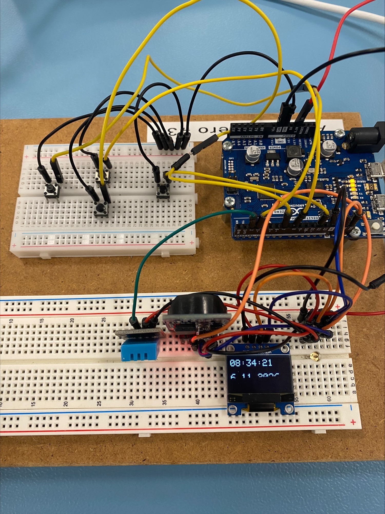
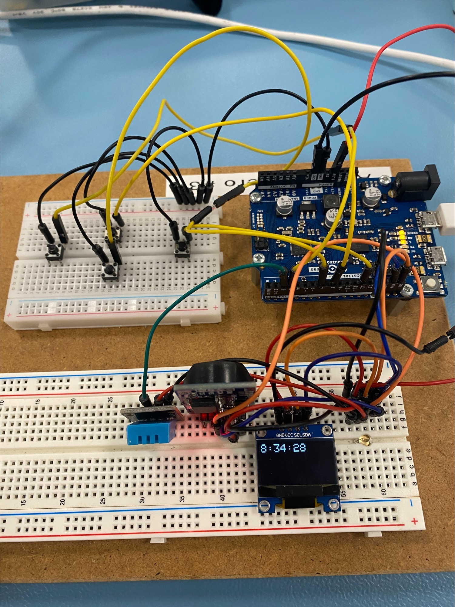
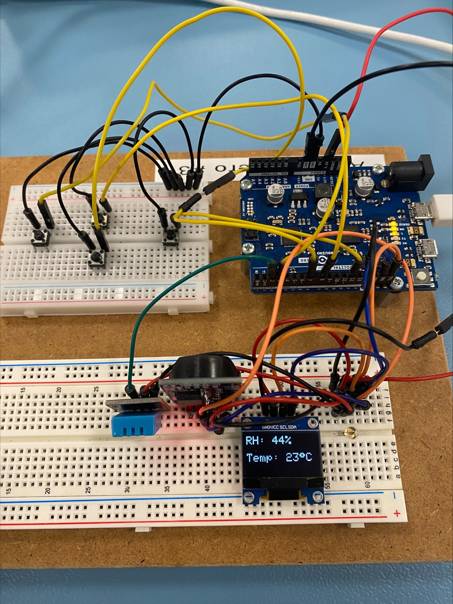
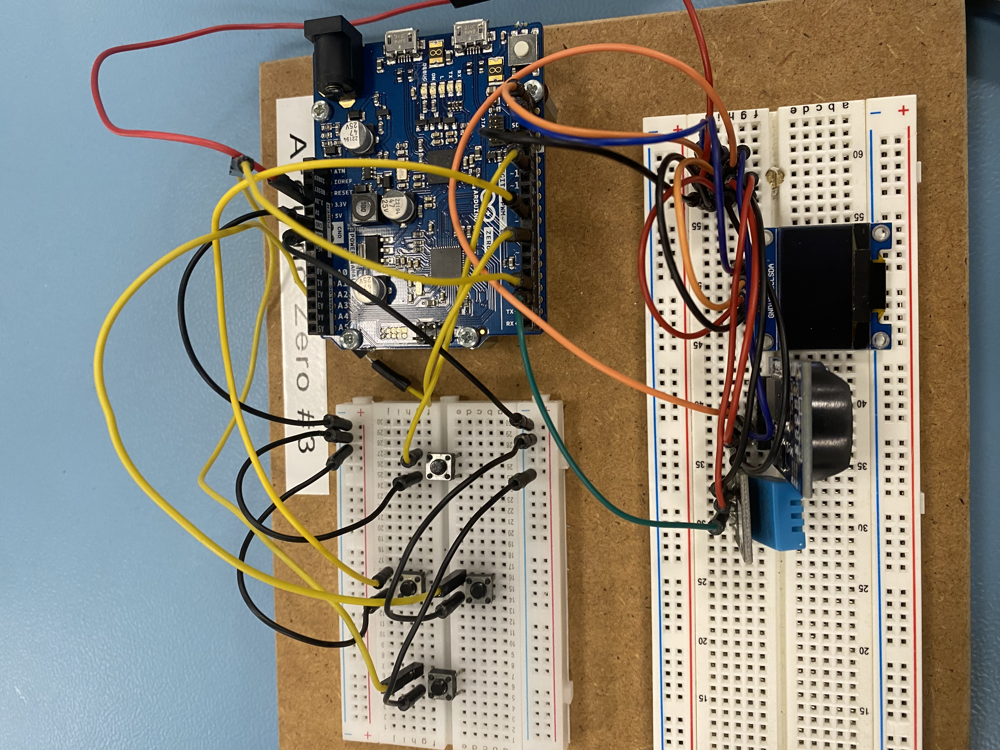

# Home Assistant – H3 Praktisk Programmering

Dette projekt er udviklet som en del af **H3 Praktisk Programmering** og fungerer som den første prototype på en simpel **Home Assistant** baseret på Arduino.

Formålet er at udvikle et system, der kan vise og overvåge forskellige informationer fra hjemmet, såsom klokkeslæt, temperatur og luftfugtighed.

Projektet er designet med mulighed for fremtidige udvidelser og integration af yderligere funktioner.

## Indholdsfortegnelse

1. [Introduktion](#introduktion)
2. [Krav](#krav)
3. [Installation](#installation)
4. [Brug](#brug)
5. [Funktioner](#funktioner)
6. [Fremtidige udvidelser](#fremtidige-udvidelser)
7. [Bidrag](#bidrag)
8. [Licens](#licens)
9. [Circuit](#circuit)

---

## Introduktion

Home Assistant er en Arduino-baseret prototype, der gør det nemt at aflæse informationer om indeklima og tid direkte på et OLED-display.

Systemet anvender sensorer og et realtidsur (RTC) til at indsamle og præsentere følgende informationer:

- Aktuelt klokkeslæt
- Temperatur i grader Celsius (°C)
- Relativ luftfugtighed i procent (%)

Derudover understøtter systemet manuel indstilling af klokkeslættet ved hjælp af fysiske knapper.

Projektet er udviklet med fokus på enkel betjening, overskuelig kode og mulighed for videreudvikling.

---

## Krav

### Hardware

- Arduino-board
- OLED-display (SSD1306, 128 × 64 pixels)
- DHT-temperatur- og luftfugtighedssensor (DHT11)
- RTC-modul (realtidsur / DS3231)
- Trykknapper til navigation og indstilling
- Jumperkabler og breadboard
- USB-kabel til programmering og strømforsyning

### Software

- Arduino IDE eller Visual Studio Code med Arduino-understøttelse
- Nødvendige Arduino-biblioteker:
  - `Wire v1.17.4`
  - `SPI v1.17.4`
  - `Adafruit_GFX v1.13.0`
  - `Adafruit_SSD1306 v.2.5.17`
  - `DHT v1.4.7`
  - `RTClib v2.1.4`
  - `ArduinoJson v7.4.3`

---

## Installation

Følg nedenstående trin for at installere og starte projektet.

### 1. Klon repository

```bash
git clone https://github.com/Kasperake/HomeAssistant.git
```

### 2. Åbn projektet

Åbn Arduino IDE, og indlæs projektets `.ino`-fil fra projektmappen:

`ProgrammeringsOpgave_H3_IoT_Smart_Home`

### 3. Installer biblioteker

Åbn **Library Manager** i Arduino IDE, og installer de nødvendige biblioteker.

### 4. Tilslut hardware

Tilslut OLED-display, sensorer, RTC-modul og trykknapper til Arduino-boardet i henhold til projektets pin-konfiguration.

Button table 
| Pin | Description |
|------|-------------|
| 12 | Select Button / RTC/Temp switch |
| 8 | Up Button |
| 7 | Down Button |
| 3 | Adjust/Confirm Button |

OLED table
| Pin | Component | Description |
|------|-------------|-------------|
| 2 | DHT11 | Signal |
| SCL | RTC | Clock |
| SLA | RTC | Data |
| SCL | OLED | Clock | 
| SLA | OLED | Clock |


### 5. Upload programmet

1. Tilslut Arduino-boardet til computeren.
2. Vælg det korrekte board under **Tools → Board**.
3. Vælg den korrekte port under **Tools → Port**.
4. Klik på **Upload** for at overføre programmet.

---

## Brug

Når Arduino-boardet tilsluttes strøm, starter systemet automatisk.

OLED-displayet viser informationer om klokkeslæt, temperatur og luftfugtighed.
Brugeren kan navigere mellem visningerne og manuelt indstille klokkeslættet ved hjælp af de tilsluttede trykknapper. 
Se oversigt over knapper på [Circuit](#circuit)




---

## Funktioner

### Implementerede funktioner

- **Klokkeslæt:** Visning af aktuel tid via RTC-modul.
- **Temperatur:** Måling og visning af temperatur i °C.
- **Luftfugtighed:** Måling og visning af relativ luftfugtighed i %.
- **OLED-display:** Præsentation af informationer på et 128 × 64 pixels display.
- **Manuel tidsindstilling:** Justering af timer, minutter og sekunder via trykknapper.

---

## Fremtidige udvidelser

Projektet er en prototype og kan videreudvikles med yderligere Smart Home-funktioner.

Mulige udvidelser omfatter:

- Automatisk styring af belysning.
- Overvågning af indeklima.
- Styring af luftfugter baseret på luftfugtighed.
- Wi-Fi-forbindelse og fjernovervågning.
- Integration af flere sensorer.
- Udvidet menunavigation på OLED-displayet.

---

## Bidrag

Projektet er udviklet som et undervisningsprojekt i H3 Praktisk Programmering.

---

## Licens

Dette projekt er licenseret under [MIT License](LICENSE).

## Circuit
